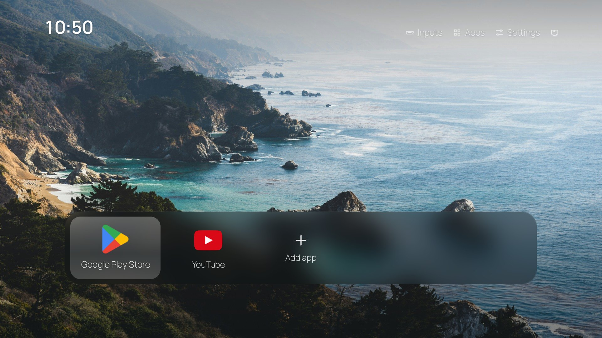

# GUIDE.md — setup, TV install and recovery

This is the human guide for this fork. For agent/session state read [AGENTS.md](AGENTS.md); for the work log read [PROGRESS.md](PROGRESS.md); for the design mapping read [docs/restyle-plan.md](docs/restyle-plan.md).



## Where things stand

- **The restyled launcher is built and verified on an Android TV 14 emulator.** It has **not** been installed on the TV yet.
- **`out/tvhome.apk` is ready to install**: signed, 3.6 MB, package `com.ansub.tvhome` 1.5.7, minSdk 21, targetSdk 34.
- No cleanup has been done on the TV. Google TV's home screen is untouched.
- The public GitHub copy lives at <https://github.com/raYhanryd/tv-detox-cleanframe>.
- No APK is committed. Build `out/tvhome.apk` locally; `install.sh` only installs that file and refuses a build older than its source.

## Tools and deleting them

Everything this project installs for development goes in `.tools/` inside this folder. Nothing is installed with Homebrew or system-wide.

| Folder | What it holds | Approx. size |
| --- | --- | --- |
| `.tools/jdk-17` | Temurin JDK **17.0.21**, used only by the build | 310 MB |
| `.tools/android-sdk` | adb **37.0.1**, platform **34**, build-tools **34.0.0**, emulator, Android TV 14 ARM64 image | 9.8 GB |
| `.tools/android-home` | adb keys/config when the tools honour `ANDROID_USER_HOME` | small |
| `.tools/avd` | `tv34` emulator (1920×1080 Android TV), | 940 MB |
| `.tools/venv` | Python + Pillow for generating wallpapers/glass | 22 MB |
| `.tools/` **total** | measured on 2026-10-31 | **~11 GB** |

Delete the whole `.tools/` folder when you are done; nothing outside it is needed for the build. A tiny `~/.android/adbkey` may still be created by adb (a few KB) and can be deleted separately.

**To remove everything this session added to the computer:** delete `.tools/` (and `~/.android` if you want adb keys gone). The project source, mockups, screenshots and docs are deliberate files, and the GitHub repo is a copy. Delete this project folder too if you want none of it locally; delete the GitHub repo in its Settings if you want it gone there.

## Building

The toolchain is installed; one line sets every path:

```sh
. tools/env.sh
sh build.sh
```

Verified on 2026-10-31: exit 0, `out/tvhome.apk`, signed with the local `key.jks`, package `com.ansub.tvhome` 1.5.7, **3.6 MB**. `apksigner verify` and `aapt2 dump badging` pass.

`build.sh` creates `key.jks` on the first build. **Keep `key.jks`**; future updates must be signed with the same key. It is git-ignored, so back it up if you plan to update an installed build from another machine.

## Putting it on the TV

Do this after reading the recovery section. The TV is stock and nothing has been changed on it yet.

1. On the TV: **Settings → Device Preferences → About**, press **Build** seven times. Then **Developer options → USB debugging** (and **Wireless debugging** if present).
2. Put the Mac and TV on the same Wi-Fi.
3. For Wireless debugging: TV **Developer options → Wireless debugging → Pair device with pairing code**. On the Mac:

   ```sh
   . tools/env.sh
   adb pair <TV_IP>:<PAIRING_PORT>
   # type the six-digit code
   adb connect <TV_IP>:<DEBUG_PORT>
   adb devices
   ```

   The debug port changes after a TV restart. Pair and connect again if it drops.
4. Build, then install. `install.sh` installs **only** the local `out/tvhome.apk` (it never downloads a prebuilt app), sets it as a Home candidate, and leaves the TV's own launcher on. If a source file is newer than the APK, it stops and asks you to rebuild (`ALLOW_STALE=1` overrides that):

   ```sh
   . tools/env.sh
   sh build.sh
   ```

   ```sh
   sh install.sh <TV_IP_OR_IP:PORT> "com.google.android.youtube.tv,com.netflix.ninja"
   ```

   Replace the list with the apps you want on the dock (package names, comma-separated). If you leave the list out, the first launch starts from `apps.txt` and fills the row with other installed TV apps until there are six; you can remove any of them with the remote. Passing the list makes the dock exact.

   Useful packages (check the TV's own list with `adb shell cmd package query-activities --brief -a android.intent.action.MAIN -c android.intent.category.LEANBACK_LAUNCHER`):

   | App | Package |
   | --- | --- |
   | YouTube | `com.google.android.youtube.tv` |
   | Netflix | `com.netflix.ninja` |
   | Prime Video | `com.amazon.amazonvideo.livingroom` |
   | Disney+ | `com.disney.disneyplus` |
   | Hulu | `com.hulu.livingroomplus` |
   | Max | `com.wbd.stream` |
   | Plex | `com.plexapp.android` |
   | Spotify | `com.spotify.tv.android` |
   | Apple TV | `com.apple.atve.androidtv.appletv` |

5. **Home button on this launcher:** TV **Settings → Device Preferences → Accessibility → Home button** (the app's accessibility service). It works with Google TV's launcher (`launcherx`), Android TV 9–11's (`tvlauncher`) and the older leanback launcher, without disabling any of them. On Android 13+ sideloaded apps, if the toggle is greyed out, open **Settings → Apps → See all apps → Home → ⋮ → Allow restricted settings** first. Play Protect may warn because the app has an accessibility service.
6. If the Accessibility screen freezes, enable the service over adb instead (keeps other services):

   ```sh
   adb shell '
   service=com.ansub.tvhome/.HomeButton
   services=$(settings get secure enabled_accessibility_services)
   case "$services" in null|"") services="" ;; esac
   case ":$services:" in
     *":$service:"*|*":com.ansub.tvhome/com.ansub.tvhome.HomeButton:"*) ;;
     *) services="${services:+$services:}$service" ;;
   esac
   settings put secure enabled_accessibility_services "$services"
   settings put secure accessibility_enabled 1
   '
   ```
7. Test Home, Back (hold Back opens Google TV's home), app launching, HDMI inputs, the Wi-Fi icon, the clock, and a reboot.
8. **Turn debugging off** when finished: Developer options → USB debugging, Wireless debugging, Network debugging. Left on, other devices on your network can ask to control the TV.

If Home keeps opening Google TV's launcher even after the accessibility service is on, the service did not get enabled (or the TV needs a reboot). See [Recovery](#recovery).

## What the home screen does

- **Dock:** the apps you chose, plus **Add app**. Left/right moves focus; Up reaches Inputs, Apps, Settings and the network icon; Down returns to the dock.
- **Hold OK** on an app: Move, Replace, Remove from home, and Uninstall (user apps) or App info (system apps). Remove only takes the tile away; the app stays installed.
- **Add app:** lists every launchable TV app not already on the dock.
- **Inputs:** HDMI inputs; hold OK to rename or remove one. Removed inputs come back by holding OK on **Add app**.
- **Apps:** the full app list, including apps not on the dock.
- **Settings:** Wallpaper, Apps on Home, Inputs, Show date (default Off), App labels (default On), Google TV home, Brightness (on TVs that support it), TV settings.
- **Clock:** top left, 12/24-hour format follows the TV's existing preference. Show date adds the date underneath.
- **Wallpaper:** six photos, saved on the TV when you press OK in the picker. Back leaves the current one unchanged.
- **Hold Back:** opens Google TV's own home screen and stays there until you open **Home** from its apps row or restart the TV. This is the escape hatch if this launcher misbehaves.

## Apps on Home

The dock is a saved list, not every installed app. On the first launch with nothing saved, it starts from the packages in `apps.txt` that are installed, then fills up to six with other installed TV apps. Any change you make with Add/Remove/Move/Replace is saved and becomes the exact list. Apps not on the dock are always available under **Apps**.

To clear and rebuild the list over adb (this resets it to the default seeding):

```sh
adb shell pm clear com.ansub.tvhome
```

That also clears the wallpaper and the two toggles.

## Cleanup (not started)

The cleanup changes system packages, so it waits until the launcher works and you approve each change.

```sh
sh supports.sh <TV_IP>     # read-only: model, RAM, home screens, inputs
sh candidates.sh <TV_IP>   # read-only: every app with never/keep/safe/review + reason
```

Rules we will follow:

- One small batch at a time, then check the TV and reboot.
- `pm disable-user --user 0 <package>`, **never** uninstall a system app.
- Ask before every package. Keep `cleanup-undo-YYYY-MM-DD.sh` with every change.
- Never disable: Play services/framework, Play Store, Settings, System UI, setup apps, keyboard, Bluetooth, package installer, providers, HDMI/TV input and tuner framework, anything `PERSISTENT`, or the app that saved your Wi-Fi.
- If unsure, leave it on.

Undo any single package:

```sh
adb shell pm enable <package>
```

## Google TV home

Do **not** disable it as part of cleanup. First measure how much it costs when idle:

```sh
adb shell dumpsys meminfo com.google.android.apps.tv.launcherx
adb shell dumpsys meminfo com.google.android.tvlauncher
adb shell dumpsys meminfo | grep -E "Free RAM|Used RAM|Lost RAM"
adb shell dumpsys activity processes | grep -A3 -E "launcherx|tvlauncher|leanbacklauncher"
```

Then choose, with real numbers:

1. **Leave it enabled and cached.** No boot risk; Android reclaims it under pressure. Recommended unless the numbers are bad.
2. **Force-stop it after boot.** `adb shell am force-stop com.google.android.apps.tv.launcherx`. Frees it until something restarts it; needs adb after each boot.
3. **Disable it and re-enable over adb when needed.** This is the option that caused boot loops and factory resets on some Google TVs. Only with a recovery path tested.

The launcher's Settings has a **Google TV home** row that opens it when it is installed and enabled, and shows **Disabled** or **Not available** otherwise. Hold Back is the existing shortcut.

## YouTube ads

This launcher cannot block ads in the official YouTube app: it only launches the app, and YouTube stitches ads into the same video streams from the same domains as the video. DNS-level blockers (Pi-hole, NextDNS, AdGuard DNS) generally do not remove them.

The practical options are:

- **YouTube Premium** — the supported, paid way; no ads in the official app.
- **SmartTube** — a free, open-source Android TV client with ad blocking and SponsorBlock. It is a separate third-party app, not bundled with this launcher and not from the Play Store. Install only from its official GitHub (<https://github.com/yuliskov/SmartTube>) and note the project's security notice: in 2026 its author reported a compromised development machine and reissued builds/keys. Prefer the latest official stable release and check the project page before installing.
- Do not install "adblock" APKs from random sites; they are a common malware vector on TV.

If SmartTube is installed, it appears under **Apps** and can be added to the dock like any other app.

## Recovery

- **Home opens the wrong thing:** Settings → Accessibility → **Home button** off. Or uninstall this launcher.
- **Back to the stock home:** hold Back opens whichever stock home screen the TV has. The **Google TV home** row in Settings does the same and reads *Enabled*, *Disabled* or *Not available*.
- **Uninstall the launcher:** `adb uninstall com.ansub.tvhome`.
- **Restore the stock home and remove this one:** `sh undo.sh <TV_IP>`.
- **A disabled package broke something:** `adb shell pm enable <package>`; if the TV won't boot, connect in the first seconds after power-on, `adb wait-for-device`, then re-enable packages from `pm list packages -d`.
- **Home role stuck:** `adb shell cmd package set-home-activity <stock-launcher>/<activity>` then reboot. Use `com.google.android.apps.tv.launcherx/.home.HomeActivity` on Google TV or `com.google.android.tvlauncher/.MainActivity` on Android TV 9–11; check with `adb shell cmd package resolve-activity --brief -a android.intent.action.MAIN -c android.intent.category.HOME`. (On some TVs the setup app is the fallback; the TV Detox README covers that.)
- **Boot loop after disabling Google TV's home:** re-enable `com.google.android.apps.tv.launcherx` and `com.google.android.tungsten.setupwraith` from adb as soon as the TV is reachable. A factory reset is the last resort.
- **Accessibility service loop:** `adb shell settings put secure accessibility_enabled 0`; clear `enabled_accessibility_services` if needed.
- **Wireless debugging left on:** turn it off in Developer options when done.

## Emulator

The Android TV 14 ARM64 emulator is installed under `.tools/`. It proves the UI, focus, settings persistence and absence of crashes; it cannot prove the ORCA's real GPU frame times or RAM.

```sh
. tools/env.sh
emulator -avd tv34 -no-window -no-audio -no-boot-anim -gpu host -no-snapshot-save
adb wait-for-device
adb install -r out/tvhome.apk
adb shell am start -n com.ansub.tvhome/.MainActivity
adb exec-out screencap -p > /tmp/tv.png
```

- **Use `-gpu host` for frame measurements.** `-gpu swiftshader_indirect` gave 100% jank on the same build; host graphics gave 3.7%.
- The emulator has only a YouTube stub (it shows "YouTube is not supported on this device"), Play Store and Cast. It has no HDMI inputs; use `FAKE_INPUT=1 sh install.sh emulator-5554` only for input-tile testing.
- Start the emulator as a persistent background process. A timed shell command that ends can kill it.
- Measured here: **31.7 MB PSS**, 54 frames, 2 janky (3.7%), p50 21 ms, p90 24 ms, p99 38 ms. These are emulator numbers, not the TV's.
- To remove the emulator and all project tooling, delete `.tools/` (~11 GB).

## Current design decisions

- Dock layout with a frosted glass panel, pre-rendered per wallpaper; 1504×232 at (208, 676), tiles 288×200.
- Clock top-left. **Show date** toggle (default off).
- **App labels** toggle: icons + names, or icons only (default names).
- Top-right: Inputs, Apps, Settings, network status.
- Six full-quality Unsplash photos with credits; Manrope font (OFL); no bundled brand icons (the TV supplies app icons).
- No runtime blur, no layout animations, no system animation-scale changes.

## Files worth knowing

| Path | Purpose |
| --- | --- |
| [AGENTS.md](AGENTS.md) | Rules and state for the next AI session |
| [PROGRESS.md](PROGRESS.md) | What is done, verified and next |
| [THIRD_PARTY_NOTICES.md](THIRD_PARTY_NOTICES.md) | Photo, font and project licences |
| [docs/restyle-plan.md](docs/restyle-plan.md) | Design mapping and limits |
| [docs/screenshots/](docs/screenshots/) | Final emulator screenshots |
| [mockups/](mockups/) | Mockups, credits, generator |
| [docs/debloat.md](docs/debloat.md) | Upstream cleanup rules |
| [src/com/ansub/tvhome/](src/com/ansub/tvhome/) | The launcher source |
| `build.sh`, `install.sh`, `undo.sh` | Build and TV lifecycle |
| `tools/generate_assets.py` | Regenerates shipping wallpaper/glass bitmaps |
